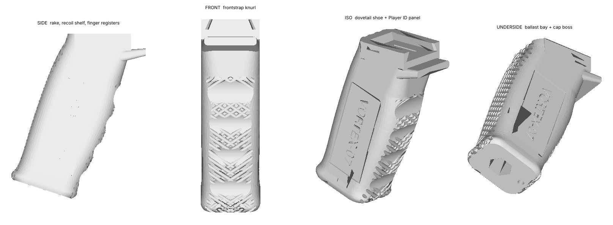

# VERTEX-1 — Parametric Launcher Grip for Beyblade X

A made-to-order aftermarket grip that turns a toy-grade winder launcher into a
tournament-grade instrument — and the parametric pipeline that manufactures one
per customer, on demand.

> ### ⚠ PROTOTYPE — the launcher interface is UNVERIFIED
>
> Every launcher dimension in this repo is a plausible **placeholder**. Nothing
> here has been measured off a physical Beyblade X launcher, so the current
> output **will not reliably fit one**. The unknown is sealed inside a single
> module (`cad/vertex/interface.py`), every build prints a banner, every file is
> stamped `_PROTOTYPE`, and every manifest carries the warning.
>
> Fixing it is a measuring session and one dict: see **[docs/03](docs/03-interface-ground-truth.md)**.



---

## The idea in one paragraph

A launcher grip is normally sold as comfort. The competitive value is elsewhere:
in Beyblade X the launch *angle* decides whether a bey catches the stadium's rail
line, and the bare launcher is small enough that every launch places the hand
slightly differently. VERTEX-1 is designed as an **angular repeatability
fixture** — its job is to make launch *n+1* identical to launch *n*. That single
framing drives the hand-registration features, the obsession with zero interface
play, and the decision to make it per-player rather than one-size-fits-all.

## Reference unit

Hand breadth 90 mm, rake 18°, knurl, 3 ballast nuts — all figures generated, not
estimated by hand:

| | | | |
|---|---|---|---|
| Printed mass (PETG) | **54.7 g** | Grip circumference | 132.7 mm |
| Print time | **1.45 h** | Bounding box | 81.4 × 30.0 × 100.3 mm |
| Build height cheek-down | 30.0 mm (150 layers) | Support material | **none** |
| Dovetail wall SF | **4.42** cheek-down / 2.54 upright | Generator runtime | ~25 s |

Envelope held across the whole 80–100 mm fit range: 46.4–60.7 g, 1.23–1.61 h.

## Quick start

```bash
pip install cadquery

cd cad
python -m vertex.build --preset ../presets/adult_mid.json --out ../out
python -m vertex.build --hand 96 --rake 14 --id "RYU-01" --nuts 4 --out ../out
python -m vertex.validate            # envelope sweep / regression test
python -m calibration.rail_gauge     # interface fit coupon -- print this first

# branded edition: per-face debossing, auto-limited draft, 32 mm body
python -m vertex.build --preset ../presets/qisi_edition.json \
       --out vertex/export --name grip_qisi_edition --exact-name --stl-tolerance 0.02
```

Each build emits `.step` (manufacturing record), `.stl` (slicer) and a `.json`
manifest with parameters, mass properties, balance, structural margins,
interface provenance and warnings.

## Documents

| | |
|---|---|
| [01 — Concept Spectrum](docs/01-concept-spectrum.md) | three archetypes, and why two of them are one part |
| [02 — Flagship Architecture](docs/02-flagship-architecture.md) | anatomy, dimensions, load path, the ballast correction |
| [03 — Interface Ground Truth](docs/03-interface-ground-truth.md) | what is unverified, and the calibration that fixes it |
| [04 — DFM and Print Spec](docs/04-dfm-and-print-spec.md) | the orientation decision and everything downstream |
| [05 — Parametric Strategy](docs/05-parametric-strategy.md) | code-to-CAD bridge, injection points, library traps |
| [06 — On-Demand Pipeline](docs/06-ondemand-pipeline.md) | order to part, and where AI actually helps |
| [07 — Qisi Tech Edition](docs/07-qisi-edition.md) | a brand build, and where its DFM gates collide |

## Layout

```
cad/vertex/        params · interface · grip · build · analysis · validate
cad/calibration/   rail_gauge.py  -- the fit coupon
cad/openscad/      dependency-free port (NOT executed -- see 05)
presets/           teen_small · adult_mid · adult_large · qisi_edition
docs/              the proposal
```

## Three decisions worth knowing up front

**Constant 30 mm lateral width; all ergonomic volume in the fore-aft depth.**
Flat parallel cheeks are correct pistol-grip ergonomics, they let the part print
support-free lying on a cheek, they put the structural load path *in-plane*
instead of across layer bonds (4.42 vs 2.54 safety factor), and they give the
customisation panel a free flat canvas. One decision, four payoffs.

**The dovetail is cut last, after every blend.** It is structurally impossible
for a future grip revision to intrude into the mating geometry — a property of
the build order, not of anyone remembering to check.

**Ballast lowers the CoG; it does not counterbalance.** The bay drops the centre
of gravity 15.4 mm and cuts the lever above the hand by 32 %, which is real and
worth selling. It does *not* reduce the wrist's static load (it slightly
increases it) and adds only 3 % inertia, because mass inside the butt sits
forward of the wrist. The analysis that says so is in the repo, and the number
that would flatter the product is the one left out. See
[02 §1.7](docs/02-flagship-architecture.md).

## Status

Verified here: geometry builds as a single valid solid across the full
parameter range; mass, time, girth and structural margins hold the envelope;
order validation refuses out-of-range input.

Not verified here, and required before anything ships —
**[docs/06 § What has to be true before selling one](docs/06-ondemand-pipeline.md)**:
measure a real launcher, calibrate each printer, pull-test to confirm the
predicted failure mode, fit-test the ergonomics on real hands, weigh a launcher
for the balance model, and cycle-test the interface.
