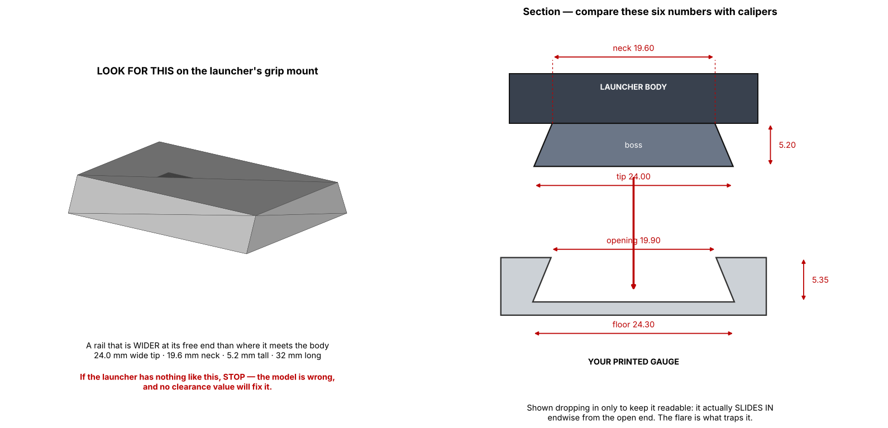

# 03 — The Interface: Ground Truth and Calibration

## The problem, stated plainly

The brief says to treat the launcher's mounting interface as immutable ground
truth. It is. **But I do not have it.**

Every dimension in `interface.RAIL_NOMINAL` is a plausible placeholder chosen to
exercise the generator end to end. Nothing in this repository has been measured
off a physical Beyblade X launcher. Printing the current output and expecting it
to fit a real launcher will not work, and the honest thing is to say so in the
code, in the filenames and here, rather than let a confident-looking STEP file
imply a confidence that does not exist.

So the build prints this on every run, stamps `_PROTOTYPE` into every filename,
and writes a warning into every manifest:

```
======================================================================
 INTERFACE GEOMETRY IS UNVERIFIED PLACEHOLDER DATA
 Output is a PROTOTYPE. It will not reliably fit a real
 launcher. See cad/vertex/interface.py and docs/03.
======================================================================
```

## How the unknown is contained

One file. `cad/vertex/interface.py` is the **only** place in the codebase where
launcher geometry appears. Nothing downstream reasons about the launcher; it
consumes `rail()` and `build_shoe()` and nothing else.

That containment is the point. When somebody finally puts calipers on a real
launcher, they fill in `RAIL_MEASURED`, flip `RAIL_VERIFIED = True`, and **every
size, every rake and every preset re-cuts correctly from one dict**. No hunting
for hard-coded numbers across the grip, the collar and the gauge.

```python
RAIL_VERIFIED = False
RAIL_NOMINAL  = {...}      # plausible placeholders
RAIL_MEASURED = {}         # <- populate from a physical sample
def rail():                # measured wins, key by key
    return {**RAIL_NOMINAL, **RAIL_MEASURED}
```

Measured values override nominal ones *key by key*, so a partial measuring
session is still useful — measure the three dimensions you are confident in,
leave the rest, and `provenance()` reports `PARTIAL` rather than claiming
verification it has not got.

## What the gauge is checking against



Both halves of that picture are generated from `RAIL_NOMINAL`, so the left-hand
panel is the question, not the answer: does the launcher actually carry a rail
wider at its tip than at its base? If it does not — if the mount is a pair of
pegs, a narrow tab or a clip — the gauge cannot report anything useful and no
clearance value will rescue it. That is a `RAIL_MEASURED` problem, not a
tolerance problem, and it is worth five seconds of holding the coupon up to the
launcher before test-fitting anything.

## What to measure

| Key | What it is | How |
|---|---|---|
| `boss_width_bottom` | widest point of the launcher's dovetail | calipers, 3 places along the boss, take the max |
| `boss_width_top` | narrowest point, at the launcher body | calipers, 3 places, take the min |
| `boss_height` | vertical extent of the dovetail | depth gauge |
| `slide_length` | engagement travel along the launch axis | calipers, boss to hard stop |

Take readings from **at least three launchers**, ideally from different
production runs. Injection-moulded toy parts carry real cavity-to-cavity
variation, and the grip has to fit the population, not one sample. Record the
spread — it sets how much preload the taper and leaf have to absorb.

## Why clearance is measured, not derived

The clearance that gives a dead-solid fit is not derivable. It is the sum of the
launcher's real geometry, the printer's XY flow compensation, the filament, the
nozzle and the humidity that day. **Two printers in the same fleet, running the
same file, land 0.1 mm apart.** Any single number committed to the repo is
already wrong for somebody.

So the pipeline measures it, once per printer/material pairing:

```
python -m calibration.rail_gauge --out out/
```

Produces a 34 × 176 × 8.5 mm coupon — five dovetail stations at −0.05, 0.00,
+0.05, +0.10 and +0.15 mm, each with its clearance debossed on the top face in
the flat margin beside its pocket. Zero support in the as-exported
orientation (verified on the mesh, not asserted).

`--stations 3` prints a reduced ladder when a full sweep is not needed.

The script prints its own time estimate for several profiles rather than
quoting one here, because the first version of this document quoted "roughly
15 minutes" from nobody having run the numbers. It was really 2.5–4 h: the
gauge repeated the full production shoe five times and so carried *more*
surface area than the grip itself, and the leaf spring's relief slot was the
one feature on this project that forces support. It is now stripped to what it
measures — minimum floor, no leaf, flat-bottomed plate — and runs ~36 min on a
0.6 mm nozzle at 0.3 mm, ~79 min on 0.4 mm at 0.2 mm.

1. Print flat, on the **same printer, material and profile** as the grip.
2. Try each station on the launcher, tight to loose.
3. Keep the **tightest that seats fully by hand** — no tool, no force.
4. Write it into `FIT_CLEARANCE_DEFAULT`, or the machine profile, and rebuild.
5. Re-run whenever filament, nozzle or printer changes.

The gauge imports the **same `build_shoe()` the product uses**. A gauge with its
own copy of the dovetail would drift out of sync on the first revision and
quietly certify the wrong fit — the most expensive kind of bug, because
everything downstream still looks fine.

## Why the fit does not depend on getting clearance right

Calibration gets the parts together. It is not what holds them. Three features
do, and they are listed in the order they take up slack:

1. **Dovetail flanks, 22.9°** — resist straight-out separation. Geometry, not
   tolerance.
2. **Wedge taper, 1.2°** — the pocket narrows toward the closed end, so the
   launcher wedges tight *as it seats*. This absorbs lateral and rotational play
   across the whole ±0.15 mm print spread. A part 0.1 mm loose simply slides 2 mm
   further before it jams.
3. **Compliant floor leaf** — a printed cantilever standing 0.8 mm proud, pushing
   the boss up into the flanks. Takes out vertical slack independently of how the
   clearance landed.

Then, for match play only, the **Tournament Lock**: an M3 nylon-tipped grub screw
in a brass heat-set insert, bearing on the dovetail flank. Nylon tip so it does
not mar a launcher a blader may want to use bare.

The design intent is that a grip which comes out 0.1 mm loose is still a
tournament-grade fit, because nothing load-bearing depends on the clearance
being right. That is the difference between a part that works on our printer and
a product.

## Before the first saleable unit

- [ ] Measure ≥3 launchers; populate `RAIL_MEASURED`; set `RAIL_VERIFIED = True`
- [ ] Print the gauge on each production printer; record per-machine clearance
- [ ] Verify zero wobble under a hard pull — the design target is < 0.5° of play
- [ ] 500-cycle mount/dismount test: confirm the leaf still preloads and the
      dovetail has not worn loose
- [ ] Confirm the lock screw does not mar the launcher after 50 cycles
- [ ] Weigh a launcher and find its balance point; populate
      `analysis.LAUNCHER_MASS_G` / `LAUNCHER_COG` and set
      `LAUNCHER_PROPS_VERIFIED = True` — until then every balance figure in the
      manifest is directional only, and is labelled as such
